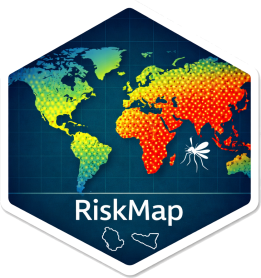

<!-- README.md is generated from README.Rmd. Please edit that file. -->

```{r setup, include = FALSE}
# The example runs when this file is knitted, which takes under a minute with
# RiskMap and geobounds installed and downloads the boundary of Liberia. Its
# map is also shown on the home page of the site (pkgdown/index.md). Knit with
# devtools::build_readme().
knitr::opts_chunk$set(
  collapse = TRUE,
  comment = "#>",
  fig.path = "man/figures/README-",
  dev = "png",
  dpi = 210
)
set.seed(2026)
```

# RiskMap 

<!-- badges: start -->
[](https://CRAN.R-project.org/package=RiskMap)
[](https://github.com/claudiofronterre/RiskMap/actions/workflows/R-CMD-check.yaml)
<!-- badges: end -->

Model-based geostatistics in R. Fit spatial models to survey data, predict
disease risk at locations and over areas, and quantify its uncertainty.

RiskMap implements generalised linear geostatistical models for Gaussian,
binomial, Poisson and negative binomial outcomes. It was developed for public
health, for example to map the prevalence of a disease from surveys, and
applies to any outcome measured at geo-referenced locations.

With RiskMap you can

- choose a projection that keeps distances accurate, explore spatial
  correlation, and download population counts from WorldPop,
- fit models with `glgpm()` and check them with `check_fit()`,
- predict with `predict()` at new locations or over areas, for targets such
  as prevalence, the probability of exceeding a threshold or a
  population-weighted average,
- assess predictive performance by spatial cross-validation and on simulated
  data.

## Installation

RiskMap 2.0 is not yet on CRAN, so install it from GitHub. It contains C++
code, which needs [Rtools](https://cran.r-project.org/bin/windows/Rtools/) on
Windows and the Xcode command line tools on macOS.

```{r install, eval = FALSE}
# install.packages("remotes")
remotes::install_github("claudiofronterre/RiskMap")
```

`install.packages("RiskMap")` installs RiskMap 1.0.0 from CRAN, whose
interface is different.

## Get started

The `liberia` data give, for 90 villages, the number of people examined for
the nodules of river blindness and the number found with them. This example
fits a binomial geostatistical model to the counts and maps the predicted
prevalence across Liberia.

```{r example, message = FALSE, fig.width = 4.2, fig.height = 3.9, fig.alt = "Map of the predicted prevalence of river blindness nodules across Liberia, from about 5% on the south coast to over 25% in the north-west."}
library(RiskMap)
library(sf)
library(geobounds)

data(liberia)
liberia <- st_as_sf(liberia,
                    coords = c("long", "lat"),
                    crs = 4326)
crs <- propose_crs(liberia)
liberia <- st_transform(liberia, crs)
border <- st_transform(gb_get_adm0("Liberia"), crs)

fit <- glgpm(npos ~ gp(),
             data = liberia,
             family = "binomial",
             denominator = ntest)

grid <- create_grid(border, spacing = 2.5)
prediction <- predict(fit, newdata = grid)
plot(prediction)
```

The boundary is from [geoBoundaries](https://www.geoboundaries.org/) (UNMIL
and OCHA ROWCA), under CC BY 3.0 IGO.

## Learning RiskMap

The book [*Model-based geostatistics for global public health using
R*](https://www.mbgr.org/), by Emanuele Giorgi and Claudio Fronterre, teaches
model-based geostatistics with RiskMap through analyses of real data from
public health, and is free to read online.

## RiskMap 2.0

RiskMap 2.0 is a redesign of version 1.0.0. Many functions have been renamed,
merged or removed, and prediction at locations and over areas now goes through
a single `predict()` method, so code written for 1.0.0 needs changing. The
[NEWS](https://claudiofronterre.github.io/RiskMap/news/) lists the main
changes, with a table of the functions of 1.0.0 and their replacements.

## Citation

To cite RiskMap, please use

Giorgi, E., Fronterre, C. and Smart, S. (2026). *RiskMap: Geostatistical
Modeling of Spatially Referenced Data*. R package version 2.0.0.
<https://claudiofronterre.github.io/RiskMap/>

`citation("RiskMap")` in R gives the same reference with a BibTeX entry.
Please report bugs and suggest features in the [issue
tracker](https://github.com/claudiofronterre/RiskMap/issues).
